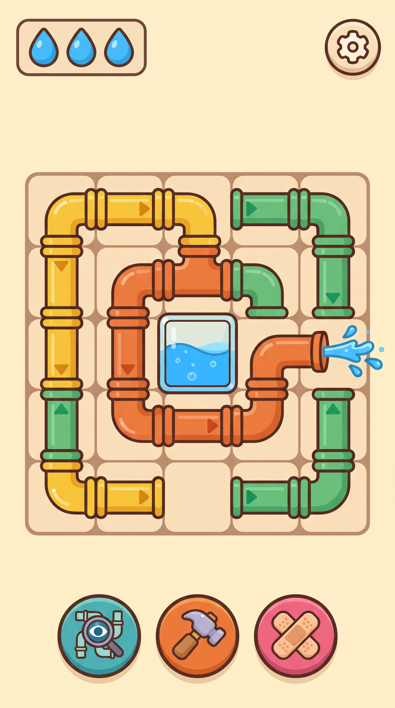
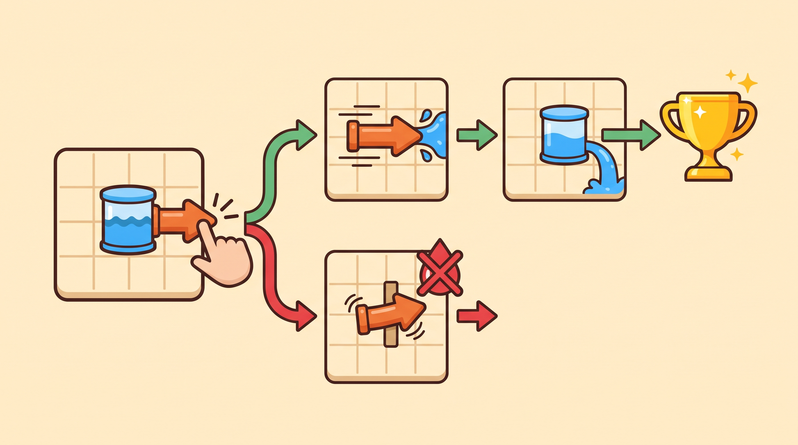

# Su Ustası (Flush Master)

One-touch, hyper-casual **tap-to-remove** pipe puzzle for iOS/Android. A water tank sits in the middle of the board,
surrounded by interlocking pipes. Tap a pipe: if its whole body can slide out along its nozzle arrow, it leaves, water
sprays out and the tank drains. If anything is in the way, the pipe shakes, the blocker flashes red and you lose one of
your 3 leak lives. Drain the tank to win.

<p align="center">
  
</p>
<p align="center"><em>Gameplay & HUD reference: lives (top-left), settings (top-right), board with the central tank, X-Ray / Hammer / Patch boosters.</em></p>


<p align="center"><em>Core loop: tap → (clear) slide out + spray → tank drains → trophy, or (blocked) shake + red flash → −1 drop.</em></p>

The repo contains two deliverables that share one rule set:

| | |
|---|---|
| [`unity-project/Assets/_Game/`](unity-project/Assets/_Game) | Unity 2D (URP) C# codebase: rules core, reverse-build generator + solver, services, runtime views/HUD, Editor + batch-mode tools, NUnit EditMode tests, JSON level pack |
| [`web-playable/`](web-playable) | Zero-dependency HTML5 Canvas/JS playable using the same rules, palette, Web Audio SFX and JSON levels |

The C# and JavaScript implementations are kept in lockstep. For the same seed the C# generator writes **byte-identical**
level files, and the C# solver reproduces every metric and solution of the JS solver (`npm run test:cs` checks both).

---

## Quick start

```bash
npm run play            # zero-dependency static server → http://localhost:8080
                        #   ?dev=1      metrics panel, auto-solve (S), level stepping (N/P), drop a level JSON to play it
                        #   ?level=35   jump to a level
npm test                # 45 JS rule/meta/generator/pack tests (node:test)
npm run validate        # every shipped level: schema, 100% solvable, replay, both copies identical, Level 8 == GDD
npm run levels          # regenerate the pack into web-playable/levels AND unity-project/.../Resources/Levels
npm run test:cs         # compile the Unity C# headless (Roslyn on a .NET 6+ runtime) + 88 NUnit tests + C#↔JS cross-check
npm run sprites         # re-slice the reference sheets into transparent sprites (needs Python + Pillow)
```

`web-playable/index.html` also opens straight from disk (`file://`). Browsers block `fetch()` of local JSON there, so the
page falls back to `levels/levels.bundle.js`, which holds the same data.

Unity: open `unity-project/` with **Unity 2022.3 LTS** (or Unity 6). Accept the Input System prompt, run
**Su Ustası ▸ Setup ▸ Create Main Scene** once, then press **Play**. `GameBootstrap` builds the camera, board, HUD and
services at runtime, so no prefabs or scene wiring are needed. It also works in any empty scene.

---

## Repository layout

```
reference-assets/            official art references (HUD, 8 pipe sprites, Usta mascot, core loop)
tools/
  slice_sprites.py           cuts pipes_spritesheet.jpg / mascot_usta.jpg / HUD icons into transparent PNGs
  generate_levels.mjs        reverse-build pack builder (JS) → both level folders + manifest + file:// bundle
  validate_levels.mjs        pack validator (also used by the test suite)
  run_csharp_tests.mjs       headless C# build + NUnit + C#↔JS cross-check (no Unity / no .NET SDK needed)
  csharp/                    NUnitLite entry point + HeadlessCli (validate / crosscheck / generate)
  reference_levels/          GDD Level 8, copied verbatim into the pack
  tests/                     node:test suites
web-playable/
  index.html, css/style.css
  js/core.js                 rules core (UMD — browser global + Node require)
  js/solver.js               deterministic solver + difficulty metrics
  js/generator.js            reverse-build generator
  js/audio.js                Web Audio synthesized SFX
  js/game.js                 renderer, input, flow, boosters, FTUE, meta, mock services
  levels/                    level_XXX.json + manifest.json + levels.bundle.js
  assets/                    reference JPGs + sprites/ (sliced PNGs + sprites.json)
unity-project/
  Packages/manifest.json     URP 14, Input System, uGUI, Test Framework, 2D Sprite
  Assets/_Game/
    Scripts/Core/            SuUstasi.Core      Board, Pipe, PathScanner, GameSession, LevelJson, LevelValidator,
                                                Progression, AdPolicy, DifficultyCurve, DeterministicRandom, StateMachine
    Scripts/LevelGen/        SuUstasi.LevelGen  LevelGenerator, LevelSolver, DifficultyScorer, LevelPackBuilder
    Scripts/Services/        SuUstasi.Services  IAdsService, IAnalyticsService, ISaveService, IIapService + mocks
    Scripts/Gameplay/        SuUstasi.Gameplay  BoosterController, EconomyService, InterstitialGate, SfxRecipes
    Scripts/Runtime/         SuUstasi.Runtime   GameStateMachine, BoardView, PipeView, TankView, HudView, SfxPlayer …
    Scripts/Editor/          SuUstasi.Editor    Level Generator window, batch CLI, sprite import, URP/scene setup
    Tests/EditMode/          NUnit suite (Unity Test Runner + headless NUnitLite)
    Resources/Levels/        level pack (identical to web-playable/levels)
    Resources/Sprites/       Pipes/, Mascot/, UI/ sliced sprites
    Sprites/References/      the 4 reference JPGs
```

Core, LevelGen, Services, Gameplay and Tests are **engine-free C#**. They only use `UnityEngine.Vector2Int`, and outside
Unity a shim (`Core/Shims/Vector2IntShim.cs`) stands in for it, so CI can build and test them without a Unity licence.

---

## Rules (as implemented)

**Grid.** `(0,0)` is top-left, `x` grows right, `y` grows down. Boards scale from 5×5 (2×2 tank) to 9×11 (3×3 tank). The
tank is immutable, and no pipe's exit path may ever cross it (the validator rejects such levels).

**Swept-path scan (`PathScanner`).** Every cell of the tapped pipe casts a ray in the nozzle direction to the board
edge, ignoring the pipe's own cells. Straight and L-shaped (elbow) pipes therefore slide as one rigid body. The scan
returns `CanExit`, `BlockingPipeIds` (nearest first) and `SweptCells`, plus `HitsTank`.

**Non-blocking input.** A successful exit frees the pipe's cells in the logical `Board` immediately, while the view
animates the slide over 0.6 s. Players can chain taps without waiting, and tests assert this.

**Tank & win/lose.** Water ratio = remaining water-bearing cells / initial water-bearing cells. You win when every
water-bearing pipe is gone (dry pipes may stay) and lose when leak lives reach 0. Levels 1–3 (FTUE) never cost lives,
though mistakes still count against the flawless bonus.

| Type | From | Mechanic |
|---|---|---|
| `straight` | 1 | 2–5 cell line; slides along its nozzle (axial or sideways). |
| `elbow` | 8 | 3–5 cell L; the whole body sweeps in the nozzle direction. |
| `dry` (#8D99AE) | 12 | No water: optional, doesn't count for the win, but blocks until removed. |
| `rusty` (#A5673F) | 16 | 1st tap breaks the rust (free, even if blocked) and makes it a normal water pipe; 2nd tap slides it. |
| `frozen` (#BDE9FF) | 22 | `iceCount` drops by 1 whenever any other pipe exits. Tapping while frozen = shake + 1 leak. |
| `locked` + `key_valve` | 30 | `key_valve.targetId` → the locked pipe. The lock opens when its key exits; an early tap = 1 leak. |
| `leaking` (#5BBE7A) | 35 | `leakTimerMoves` (default 6) drops on every tap. At 0 → 1 leak and the timer resets. |
| `rotary_valve` | 61 | Each tap rotates it 90° clockwise for free. If the new direction is clear, it slides out after 0.5 s. |

**Boosters.** X-Ray (unlocks at L5) highlights the pipes a tap would remove for 3 s. Hammer (L10) removes any pipe
regardless of blockers; this counts as an exit for ice and keys, not as a tap. Patch (L15) gives +1 leak life, capped at 4.
Each booster is gifted once at its unlock level and can be bought with coins or a rewarded ad.

**Economy & meta.** A win pays 20 coins, +10 if flawless (0 mistakes), +20 on breather levels (every 5th). Ranks:
Çırak 1–19, Kalfa 20–49, Usta 50–99, Başusta 100+. Themes cycle every 20 levels: Banyo → Mutfak → Apartman Bodrumu →
Fabrika → Şehir Kanalı → Arıtma Tesisi.

**Ads.** No interstitials in levels 1–3, never on fail, at most one per 60 s, and one every 2nd eligible win
(`AdPolicy`, unit-tested with an injected clock). Rewarded ads offer +1 drop on the fail screen and free boosters.

**Analytics.** `level_start`, `level_complete`, `level_fail`, `blocked_tap`, `booster_used`, `ad_impression`,
`iap_purchase`, `ftue_step`. They are typed helpers in `AnalyticsEvents.cs`; on the web, `window.SU_ANALYTICS.log` holds
them.

**Visual & audio.** GDD palette: water #36A2FF, pipes #F2B632 / #E8743B / #5BBE7A, error #E5484D, background #FFF4E0.
Water SFX rise 2 semitones per consecutive success, a blocked tap gives a metallic bonk, and a win plays a drain gurgle.
All sounds are synthesized; there are no audio files (`audio.js` / `SfxRecipes.cs`).

---

## Level JSON

```json
{
  "level": 8,
  "grid": [6, 6],
  "tank": { "x": 2, "y": 2, "w": 2, "h": 2 },
  "leaks": 3,
  "pipes": [
    { "id": "p1", "type": "straight", "cells": [[0,1],[1,1]], "dir": "left" },
    { "id": "p2", "type": "straight", "cells": [[4,4],[4,5]], "dir": "right" },
    { "id": "p3", "type": "straight", "cells": [[5,0],[5,1]], "dir": "up" },
    { "id": "p4", "type": "elbow", "cells": [[4,1],[4,2],[5,2]], "dir": "right" },
    { "id": "p5", "type": "straight", "cells": [[2,5],[3,5]], "dir": "right" },
    { "id": "p6", "type": "straight", "cells": [[2,4],[3,4]], "dir": "down" }
  ]
}
```

Mechanic-specific fields (one pipe each, taken from shipped levels):

```json
{ "id": "p2", "type": "frozen", "cells": [[3,0],[4,0],[5,0],[6,0]], "dir": "right", "iceCount": 2 }
{ "id": "p8", "type": "key_valve", "cells": [[0,4],[1,4]], "dir": "left", "targetId": "p5" }
{ "id": "p1", "type": "leaking", "cells": [[1,0],[2,0],[3,0],[3,1]], "dir": "up", "leakTimerMoves": 6 }
{ "id": "p2", "type": "rotary_valve", "cells": [[4,0]], "dir": "left" }
```

`dir ∈ up | right | down | left`. Optional fields: `leaks` (default 3), `iceCount` (frozen), `targetId` (key_valve →
locked), `leakTimerMoves` (leaking, default 6) and `color`. `LevelJson` (C#) and `validateLevel` (JS) report every
schema and structural error. Those cover shapes, overlaps, tank cells, exit paths through the tank, and dangling
keys/locks. Unity's `JsonUtility` cannot read nested arrays, so both sides use a small built-in JSON parser.

`level_008.json` is the GDD reference **verbatim** (byte-identical, enforced by tests). The solver verifies it: chain
depth 3 (layers 3 → 2 → 1), 3 pipes exitable on turn 1, deceptive-arrow ratio 0.333.

---

## Reverse-build generator & solver

**Generator** (`LevelGenerator.cs` / `generator.js`, bit-identical):

1. Start with an empty board and the central tank, then place pipes in **reverse exit order**. The first pipe placed
   leaves last, so its swept exit path only has to avoid the tank.
2. Each later pipe must keep its own exit path clear of the tank and of every pipe already placed, since those are still
   on the board when it leaves. Its **body may lie inside earlier pipes' exit paths**, which creates the
   directed-acyclic dependencies. Candidates are scored on dependency appetite (tuned to the target difficulty), chain
   height vs target depth, compactness and length, with seeded noise.
3. Mechanics are overlaid without breaking the canonical order. Ice counts never exceed the number of earlier exits,
   keys always leave before their lock, leaking pipes sit near the front of the chain, and valves start rotated away
   from their exit.
4. Every candidate is re-checked by the independent solver: valid, 100% solvable, **zero lives lost under perfect
   play**, at least 1 initial exit, breathers ≥ 40 % initially exitable, and intro levels showcasing their mechanic. Out
   of 40 seeded attempts, the one closest to the target difficulty is kept.

**Solver** (`LevelSolver.cs` / `solver.js`). Removal is monotone: an exit only frees cells, thaws ice and opens locks.
So "keep removing anything removable" reaches the unique fixpoint, and greedy search is exact for solvability. Leak
timers are the only order-sensitive rule, so the play-out prioritises the most urgent leaking pipe and its blocker
closure, then reports the lives that perfect play loses.

| Metric | Definition |
|---|---|
| `MaxChainDepth` | Number of simultaneous-removal layers until all water is gone (= longest dependency chain). |
| `InitialExitableCount` | Pipes a first tap would remove. |
| `DeceptiveArrowRatio` | Non-valve pipes whose arrow points at their nearest board edge yet are blocked, ÷ all non-valve pipes. |
| `DifficultyScore` | 1–10 = 1 + 9 × (0.22·count + 0.28·depth + 0.18·closedness + 0.12·deception + 0.20·mechanic load). |

The target is a sawtooth: a smooth rise `1.6 + 7.4·(1 − e^{−(L−1)/45})` plus per-level offsets −0.6/−0.2/+0.2/+0.6,
with every 5th level a −1.8 breather.

**Shipped pack.** 53 validated levels (1–36 contiguous plus samples up to L116), mean |score − target| = 0.19, all 8
mechanics covered:

| Levels | # | Board | Pipes | Depth | Difficulty | Mechanics |
|---|---|---|---|---|---|---|
| 1–3 | 3 | 5×5 | 3–5 | 1–2 | 1.0–2.2 | straight (FTUE) |
| 4–14 | 11 | 6×6 | 4–8 | 1–5 | 1.1–4.2 | + elbow (8), dry (12) |
| 15–29 | 15 | 7×7 | 6–11 | 2–5 | 2.0–5.6 | + rusty (16), frozen (22) |
| 30–49 | 10 | 7×8 | 8–12 | 2–6 | 3.3–6.2 | + locked/key_valve (30), leaking (35) |
| 50–79 | 8 | 8×9 | 10–15 | 4–9 | 4.7–8.4 | + rotary_valve (61) |
| 80–116 | 6 | 9×11 | 13–18 | 4–7 | 5.1–8.3 | all |

Per-level metrics, seeds and solutions are in `levels/manifest.json`. Regenerate from the terminal (`npm run levels`),
from Unity (**Su Ustası ▸ Level Generator**, with a preview grid and solver read-out) or in CI:

```bash
Unity -batchmode -quit -projectPath unity-project -executeMethod SuUstasi.EditorTools.LevelGenCli.GeneratePack -levels 1-36,61 -webOut ../web-playable/levels
Unity -batchmode -quit -projectPath unity-project -executeMethod SuUstasi.EditorTools.LevelGenCli.ValidatePack
```

---

## Unity architecture

- **`GameStateMachine`** is the conductor MonoBehaviour. It runs a `StateMachine<GameState>` with explicit transitions
  (Boot, Playing, Hammer, Paused, Won, Lost) and turns input into `GameSession` calls and view events. It also handles
  win/lose screens with the Usta mascot, rewards, ad pacing, FTUE (levels 1–3) and "new pipe" intro cards.
- **`GameSession`** holds the pure rules (tap, valve completion, hammer, patch, revive). It returns `TapOutcome` plus a
  list of `GameEvent`s for the view to play.
- **Views.** `BoardView`, `PipeView` and `TankView` build the board from procedurally generated, tinted sprites (outline,
  body, shading, flanges, chevrons and per-mechanic decorations), with animations for slide-out, shake, red blocker
  flash, valve rotation, falling chains and ice/rust particles. `HudView` is uGUI built in code and uses the sliced
  sprites for drops, gear, boosters, mascots and pipe intro cards.
- **Services.** `IAdsService`, `IAnalyticsService`, `ISaveService` and `IIapService` are resolved through
  `ServiceLocator`. Register real SDK adapters before the scene loads; otherwise the defaults are mocks: an on-screen
  ad overlay with a countdown, `LocalAnalyticsService`, a `JsonFileSaveService` in `persistentDataPath`, and
  `MockIapService`.
- **Gameplay** classes (`BoosterController`, `EconomyService`, `InterstitialGate`, `SfxRecipes`) are pure C# and covered by
  tests.
- **Input** works with the Input System package or the legacy Input Manager (`SU_INPUT_SYSTEM` via asmdef
  `versionDefines`). **URP**: sprites render with the default sprite material in both URP 2D and built-in.
  **Su Ustası ▸ Setup ▸ Create URP 2D Pipeline Asset** assigns a 2D renderer if the project has none.

## Sprites

`tools/slice_sprites.py` crops each illustration from the reference sheets. It estimates the paper background, keeps the
largest connected component (which drops the floating direction arrows and confetti), keeps water droplets for the
leaking pipe, and fills interior holes unless they are real background (chain links stay see-through). It then builds a
soft, colour-decontaminated alpha edge. The output goes to `web-playable/assets/sprites/` and
`unity-project/Assets/_Game/Resources/Sprites/{Pipes,Mascot,UI}/`, with a `sprites.json` manifest:

- 8 pipe types: `pipe_straight`, `pipe_elbow`, `pipe_dry`, `pipe_rusty`, `pipe_frozen`, `pipe_locked`, `pipe_leaking`,
  `pipe_rotary_valve`. These are used on the mechanic intro cards.
- Mascot: `mascot_happy` (win screen) and `mascot_worried` (lose screen).
- HUD (from `gameplay_hud.jpg`): `booster_xray`, `booster_hammer`, `booster_patch`, `icon_drop`, `btn_settings`.

## Verification status

| Check | Result |
|---|---|
| JS unit tests (`npm test`) | 45/45 pass |
| Pack validation (`npm run validate`) | 53 levels valid, solvable, zero lives lost, both copies identical |
| C# NUnit EditMode suite, run headless | 88/88 pass |
| C# solver vs JS manifest | 53/53 metrics and solutions identical |
| C# generator vs shipped files | 52/52 byte-identical |
| Web playable in Chrome | all 53 levels won through the real UI tap path, with no errors |
| Unity Runtime + Editor scripts | type-checked with 0 errors / 0 warnings against UnityEngine 2021.3 + UGUI + UnityEditor reference assemblies |

**Not yet verified:** the Unity scenes have not been run inside the Unity Editor itself, and the Input System and URP
code paths were not compiled (those packages' DLLs aren't on NuGet). Play-test there first.
